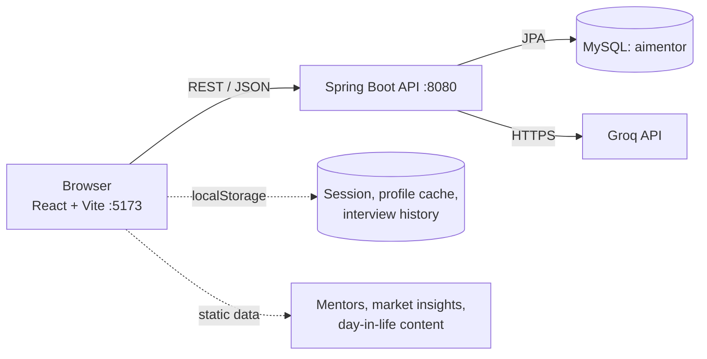

# Pathwise — AI Career Mentor Marketplace

An AI-assisted career guidance platform for students and early-career candidates. Users build a profile, take a trait-based career assessment, get ranked career recommendations, assess their skills against a target role, generate a personalised learning roadmap, and practise with an AI-driven mock interview.

> **Status:** academic / final-year project. Some modules are fully backed by the Spring Boot API, others still run on mock data in the browser. See [Implementation Status](#implementation-status) for the exact split.

## Table of Contents

- [Features](#features)
- [Implementation Status](#implementation-status)
- [Tech Stack](#tech-stack)
- [Architecture](#architecture)
- [Prerequisites](#prerequisites)
- [Installation and Setup](#installation-and-setup)
- [Environment Variables](#environment-variables)
- [How to Use](#how-to-use)
- [API Documentation](#api-documentation)
- [Database](#database)
- [AI Services (Groq)](#ai-services-groq)
- [Deployment](#deployment)
- [Troubleshooting](#troubleshooting)
- [Limitations](#limitations)
- [Future Enhancements](#future-enhancements)
- [Contributing](#contributing)


## Features

- **Account management** — sign up, log in, forgot/reset password (BCrypt-hashed passwords, 15-minute single-use reset tokens).
- **Career profile** — qualification, field, graduation year, interests, goals, skills, experience level and target role.
- **Career assessment** — a 30-statement questionnaire scored across five traits: analytical, technical, communication, leadership, creative.
- **Career recommendations** — careers ranked by matching the user's trait scores against per-career trait weights.
- **Career explorer** — detail pages, side-by-side comparison, "day in the life" scenes and market-insight charts.
- **Skill assessment** — per-career multiple-choice questions that rate proficiency for each required skill.
- **AI skill-gap analysis** — Groq-generated gap analysis between the user's skills and a career's requirements.
- **AI roadmap generation** — a step-by-step learning roadmap with trackable step completion.
- **AI mock interview** — generated interview questions (with hints) and AI evaluation of typed answers; recent attempts are kept in the browser.
- **Progress dashboard & badges** — gap progress and achievement badges computed on the client.
- **Mentor marketplace UI** — browse mentors, view profiles and chat (currently mocked; see below).

## Implementation Status

| Module | Frontend | Backend / data source |
| --- | --- | --- |
| Auth (signup, login, forgot/reset password) | Yes | Spring Boot + MySQL |
| Career profile | Yes | Spring Boot + MySQL |
| Career assessment & scoring | Yes | Questions in `src/data/questions.js`; result persisted via `/api/assessment/submit` |
| Career list / detail / recommendations | Yes | Spring Boot + MySQL (6 seeded careers) |
| Skill assessment | Yes | Spring Boot + MySQL (seeded questions) |
| Skill-gap analysis | Yes | Spring Boot + Groq API |
| Roadmap generation & step tracking | Yes | Spring Boot + Groq API |
| Mock interview | Yes | Spring Boot + Groq API (history in `localStorage`) |
| Mentor marketplace & mentor chat | Yes | **Mocked in the frontend** (`src/data/mentors.js`, canned replies). The backend has `/api/mentors` endpoints, but the UI does not call them and no mentors are seeded. |
| Day-in-the-life, market insights, compare | Yes | Static content in `src/data/` |


**Live demo:** 

## Tech Stack

| Layer | Technology |
| --- | --- |
| Frontend | React 19, Vite, React Router 7, Tailwind CSS 3, lucide-react |
| Linting | oxlint |
| Backend | Spring Boot 4.1.1 (Spring MVC, Spring Data JPA, Bean Validation), Maven wrapper |
| Security | `spring-security-crypto` (BCrypt password hashing only) |
| Database | MySQL (JPA/Hibernate, `ddl-auto=update`) |
| AI | [Groq](https://groq.com/) OpenAI-compatible chat completions API, model `openai/gpt-oss-20b` |
| Java | 26 (as declared in `backend/pom.xml`) |

## Architecture



**Typical flow**

1. The user signs up / logs in. The backend returns the user object and the frontend stores the session in `localStorage`.
2. The user fills in a profile and completes the assessment; trait scores are saved per user.
3. `GET /api/careers/recommendations/{userId}` ranks the seeded careers using the saved scores.
4. For a chosen career the user takes the skill assessment; results feed `POST /api/skill-gap/analyze`, which asks Groq for a structured gap analysis.
5. `POST /api/roadmaps/generate` asks Groq for a roadmap, which is stored as steps the user can mark complete.
6. The mock interview calls `/api/mock-interview/questions` and `/api/mock-interview/evaluate`.

The frontend talks to the backend at the hard-coded base URL `http://localhost:8080` (`src/services/api.js`, `src/services/interviewApi.js`).


## Prerequisites

- Node.js 20+ and npm
- JDK 26 (the version set in `backend/pom.xml`; lowering `java.version` may work but is untested)
- MySQL 8+ running locally on port 3306
- A free [Groq API key](https://console.groq.com/) (needed for skill-gap, roadmap and mock-interview features)

## Installation and Setup

1. **Clone the repository**

   ```bash
   git clone <your-repository-url>
   cd AI-Career-Mentor-Marketplace
   ```

2. **Create the database**

   ```sql
   CREATE DATABASE aimentor CHARACTER SET utf8mb4;
   ```

   The backend connects as MySQL user `root` (set in `application.properties`). Tables are created automatically on first start.

3. **Set backend environment variables** (see [Environment Variables](#environment-variables))

   ```bash
   # macOS / Linux
   export DB_PASSWORD="your-mysql-root-password"
   export GROQ_API_KEY="your-groq-api-key"
   ```

   ```powershell
   # Windows PowerShell
   $env:DB_PASSWORD = "your-mysql-root-password"
   $env:GROQ_API_KEY = "your-groq-api-key"
   ```

4. **Start the backend** (http://localhost:8080)

   ```bash
   cd backend
   ./mvnw spring-boot:run      # Windows: mvnw.cmd spring-boot:run
   ```

   On first run `DataInitializer` seeds careers, skills and skill-assessment questions.

5. **Start the frontend** (in a second terminal, http://localhost:5173)

   ```bash
   npm install
   npm run dev
   ```

### Other commands

```bash
npm run build           # production build -> dist/
npm run preview         # serve the production build locally
npm run lint            # oxlint
cd backend && ./mvnw test
```

> The only backend test is the default `contextLoads()` test, which requires a reachable MySQL database and the variables above.

## Environment Variables

The backend reads these from the process environment (referenced in `application.properties`):

| Variable | Required | Description |
| --- | --- | --- |
| `DB_PASSWORD` | Yes | Password of the MySQL `root` user |
| `GROQ_API_KEY` | For AI features | Groq API key, sent as a Bearer token |

Other settings are hard-coded in `backend/src/main/resources/application.properties`: DB URL `jdbc:mysql://localhost:3306/aimentor`, DB user `root`, server port `8080`, Groq URL and model.

Example template (`.env.example`, for your own shell/IDE setup — the main backend does not load a `.env` file automatically):

```dotenv
DB_PASSWORD=
GROQ_API_KEY=
```

Never commit real keys or passwords. `.env` files are already git-ignored.

## How to Use

1. Open http://localhost:5173 and **sign up**, then complete your **career profile**.
2. Take the **assessment** (30 statements) and view your result and trait scores.
3. Open **Careers** for your ranked recommendations; open a career for details, a day-in-the-life view, or compare careers.
4. Take the career's **skill assessment**, then open **Skill Gap** to run the AI analysis.
5. Open **Roadmap** to generate a learning plan and tick off steps as you complete them.
6. Use **Mock Interview** to answer AI-generated questions and read the feedback.
7. Check **Progress** for gap progress and badges, and **Market Insights** for demand trends.

## API Documentation

Base URL: `http://localhost:8080`. All endpoints are under `/api` and exchange JSON. There is no token-based authentication; the user id is passed in the path or body.

| Method | Endpoint | Purpose |
| --- | --- | --- |
| POST | `/api/auth/signup` | Create an account (name 2–100 chars, password 8–100 chars) |
| POST | `/api/auth/login` | Log in |
| POST | `/api/auth/forgot-password` | Create a reset token (see note below) |
| POST | `/api/auth/reset-password` | Reset password with `token` and `newPassword` |
| POST / PUT | `/api/profile` | Create / update profile |
| GET | `/api/profile/{userId}` | Get profile |
| POST | `/api/assessment/submit` | Save assessment trait scores |
| POST / GET | `/api/assessment-answers`, `/api/assessment-answers/assessment/{assessmentId}` | Save / read raw answers |
| GET | `/api/assessment-results/{assessmentId}` | Assessment result |
| GET | `/api/careers`, `/api/careers/{careerId}` | List / get careers |
| GET | `/api/careers/recommendations/{userId}` | Ranked recommendations |
| GET | `/api/skill-assessment/questions/{careerId}` | Skill questions for a career |
| POST | `/api/skill-assessment/submit` | Submit skill answers |
| GET | `/api/skill-assessment/result/{userId}/{careerId}` | Skill assessment result |
| GET | `/api/skill-gap/{userId}/{careerId}` | Stored skill-gap data |
| POST | `/api/skill-gap/analyze` | AI skill-gap analysis (Groq) |
| POST | `/api/roadmaps`, `/api/roadmaps/generate` | Save / AI-generate a roadmap |
| GET | `/api/roadmaps/user/{userId}`, `/api/roadmaps/user/{userId}/career/{careerId}` | Fetch roadmaps |
| PATCH | `/api/roadmaps/steps/{stepId}/completion?completed=true` | Mark a step done |
| POST | `/api/mock-interview/questions` | Generate interview questions (`careerTitle`, optional `skills`, `count` 1–10) |
| POST | `/api/mock-interview/evaluate` | Evaluate answers |
| GET | `/api/mentor-selection/{topTrait}` | Mentor suggestion by top trait |
| GET / POST / DELETE | `/api/mentors`, `/api/mentors/available`, `/api/mentors/{id}`, `/api/mentors/specialization/{specialization}` | Mentor CRUD-style endpoints (not used by the UI) |

Example:

```bash
curl -X POST http://localhost:8080/api/auth/signup \
  -H "Content-Type: application/json" \
  -d '{"name":"Asha","email":"asha@example.com","password":"password123"}'
```

Successful auth responses have the shape `{ "success": true, "user": {...}, "message": "..." }`. Request/response field details are in `backend/src/main/java/com/aicareermentor/backend/dto/`.

> **Password reset note:** there is no email delivery. The reset link is printed to the backend console, and the token is also returned in the `forgot-password` response (when the account exists). This is intended for development only.

## Database

- MySQL schema `aimentor`, managed by Hibernate (`spring.jpa.hibernate.ddl-auto=update`) — no manual migration scripts needed.
- Main entities: `User`, `Profile`, `Assessment`, `AssessmentAnswer`, `Career`, `Skill`, `CareerSkill`, `SkillAssessmentQuestion`, `SkillAssessmentAnswer`, `CareerRoadmap`, `RoadmapStep`, `Mentor`, `PasswordResetToken`.
- Seed data (`DataInitializer`): six careers — Data Analyst, Software Developer, Project Manager, Product Manager, HR Specialist, Cybersecurity Analyst — plus their skills and skill-assessment questions.
- SQL logging is enabled (`spring.jpa.show-sql=true`).

## AI Services (Groq)

- **Endpoint:** `https://api.groq.com/openai/v1/chat/completions`
- **Model:** `openai/gpt-oss-20b` (change via `groq.model`)
- **Used by:** skill-gap analysis, roadmap generation, mock-interview question generation and evaluation.
- **Auth:** `Authorization: Bearer $GROQ_API_KEY`.
- **Resilience:** the skill-gap service retries when Groq returns a rate-limit error or a response that doesn't match the expected structure.
- **Limits:** Groq enforces its own rate limits and token-per-minute quotas that depend on your account tier; check the [Groq console](https://console.groq.com/) for current limits.

## Deployment

No deployment configuration (Dockerfile, CI, hosting manifests) is included. A manual deployment would need to:

1. Build the frontend with `npm run build` and serve `dist/` from any static host (configure SPA fallback to `index.html`).
2. Build the backend with `cd backend && ./mvnw clean package` and run the jar with Java 26.
3. Provide a managed MySQL instance and set `DB_PASSWORD` and `GROQ_API_KEY`.
4. Update the hard-coded `http://localhost:8080` base URL in `src/services/api.js` and `src/services/interviewApi.js`, and the allowed origins in `config/CorsConfig.java` (currently `localhost:5173` / `127.0.0.1:5173`).

## Troubleshooting

| Problem | Likely cause / fix |
| --- | --- |
| Backend fails with `Could not resolve placeholder 'DB_PASSWORD'` or `'GROQ_API_KEY'` | The environment variable isn't set in the shell/IDE that launches Spring Boot. |
| `Access denied for user 'root'` / `Unknown database 'aimentor'` | Wrong password, or the database wasn't created (step 2). |
| `release version 26 not supported` | Install JDK 26, or point `JAVA_HOME` to it. |
| Frontend shows network / CORS errors | Backend isn't running on port 8080, or the frontend isn't served from `localhost:5173`. |
| Roadmap step checkbox fails with a CORS error | `CorsConfig` allows GET, POST, PUT, DELETE and OPTIONS but not `PATCH`; add `"PATCH"` to `allowedMethods` if the browser blocks the request. |
| AI features fail or return errors | Missing/invalid `GROQ_API_KEY`, rate limiting, or Groq unavailable — retry after a minute. |
| Reset-password link never arrives | Expected: it's printed in the backend console (see API note). |
| No careers or skill questions appear | The backend must start successfully once so `DataInitializer` can seed the database. |

## Limitations

- Authentication is lightweight: no JWT/session tokens, and the API does not verify who is calling. The session is stored client-side in `localStorage`. Not production-ready as is.
- Password reset has no email delivery and exposes the token in the API response.
- Mentor marketplace and mentor chat use mock data and canned replies.
- The API base URL, CORS origins, DB user and DB URL are hard-coded.
- Market insights, day-in-the-life content and the 30-question assessment are static data.
- Only six careers are seeded.
- The only automated backend test is the default context-load test; there are no frontend tests.

## Future Enhancements

_Proposed, not implemented:_

- Token-based authentication (e.g. JWT) with protected endpoints and role checks.
- Email delivery for password reset.
- Wire the mentor marketplace to the existing mentor API, with real mentor profiles and AI-powered chat.
- Configurable API URL via Vite env variables and configurable CORS origins.
- More careers and skills, plus admin tooling for managing them.
- Unit/integration tests and CI.
- Docker Compose setup for the full stack.

## Contributing

1. Fork the repository and create a branch: `git checkout -b feature/your-feature`.
2. Make your changes; run `npm run lint` and `cd backend && ./mvnw test`.
3. Commit with a clear message and open a pull request describing the change.

